<div align="center">
  

  <h1>PostPress · 印推</h1>
  <p>
    <b>把 X（Twitter）推文与同作者长串，渲染为出版级高分辨率卡片</b>
  </p>

  <p>
    简体中文 | <a href="README.en.md">English</a> · <a href="https://shirolin.github.io/post-to-card/">在线体验与交互图集 ↗</a>
  </p>

  <p>
    <a href="https://github.com/Shirolin/post-to-card/actions/workflows/ci.yml"></a>
  </p>

  <p>
    <code>Manifest V3</code> · <code>Preact 10 + Shadow DOM</code> · <code>12 套材质主题</code> · <code>14 种语言 (i18n)</code> · <code>100% 本地渲染</code> · <code>GPL-3.0-or-later</code>
  </p>
</div>

---

## 🚀 项目概述

**PostPress（印推）** 是一款专为 X（Twitter）打造的出版级推文卡片排印扩展。告别夹带浏览器杂乱 UI 与受限于屏幕缩放的普通截屏——在推文操作栏轻点**印刷机图标**（或按快捷键 `Alt + C`），即可在完全隔离的实时弹窗中自由搭配纸张材质、画幅比例与外层画布（Mat），一键**复制到剪贴板**或**导出 3× Retina PNG**。

所有解析、排版与光栅化均在浏览器本地完成：**无需登录、不碰账号凭据、零外部服务器通信**。

---

## 📸 效果预览

> 更多交互式切换与 12 套全量材质预览请访问产品页：<https://shirolin.github.io/post-to-card/>（源码位于 [`site/`](site/)）。

### 材质主题样张（12 选 6 展示）

| 极简 (Minimal) | 孔版 (Riso) | 暗房 (Darkroom) |
| :---: | :---: | :---: |
| 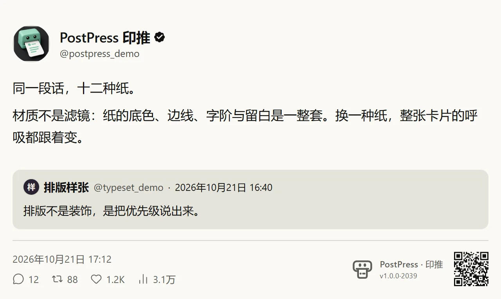 | 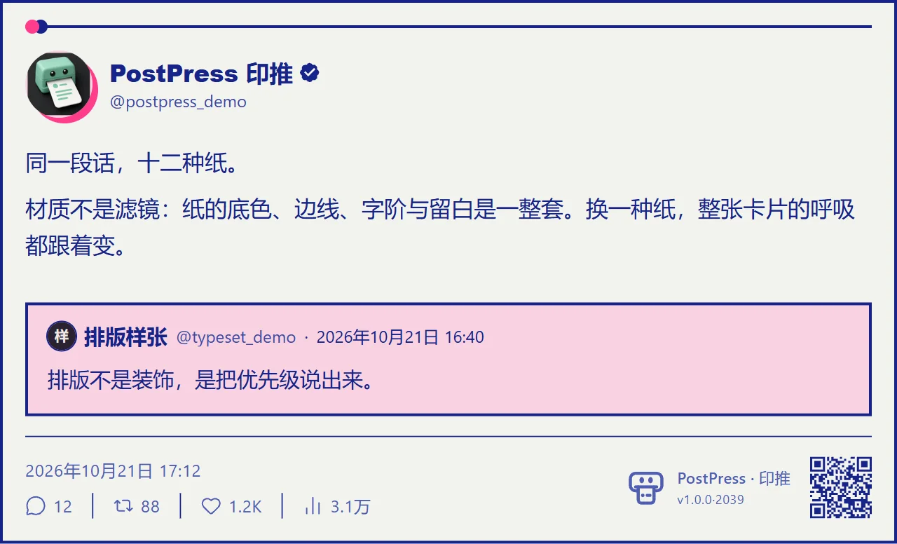 | 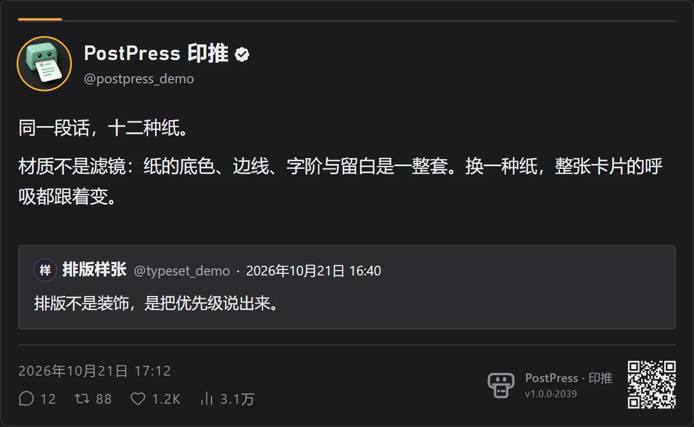 |
| **水墨 (Sumi)** | **液态玻璃 (Liquid Glass)** | **小票 (Receipt)** |
| 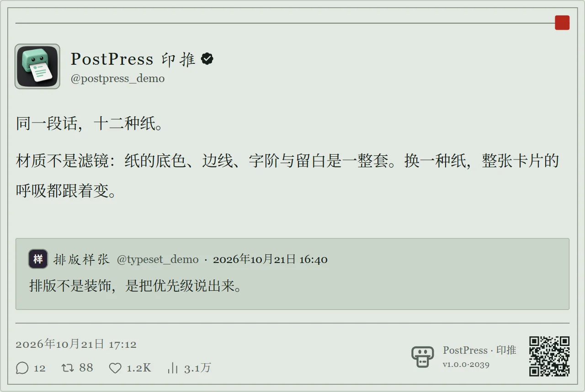 | 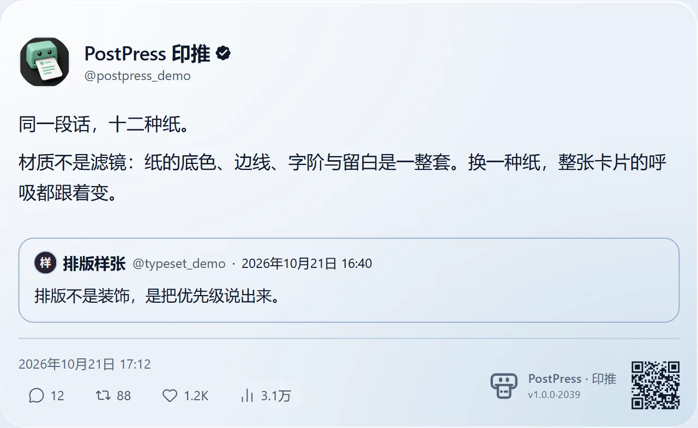 | 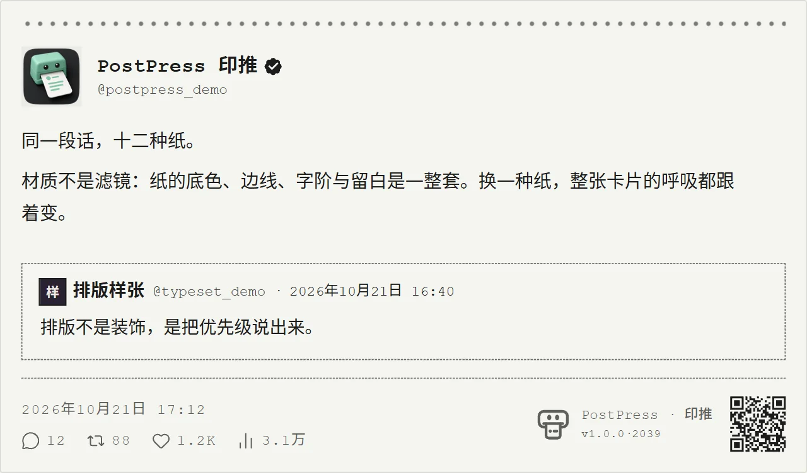 |

### 长串串联、长文排版与实时控制面板

| 同作者长串串联 (Thread) | X 长文推文排版 (Article) | 实时定制控制面板 (Controls) |
| :---: | :---: | :---: |
| 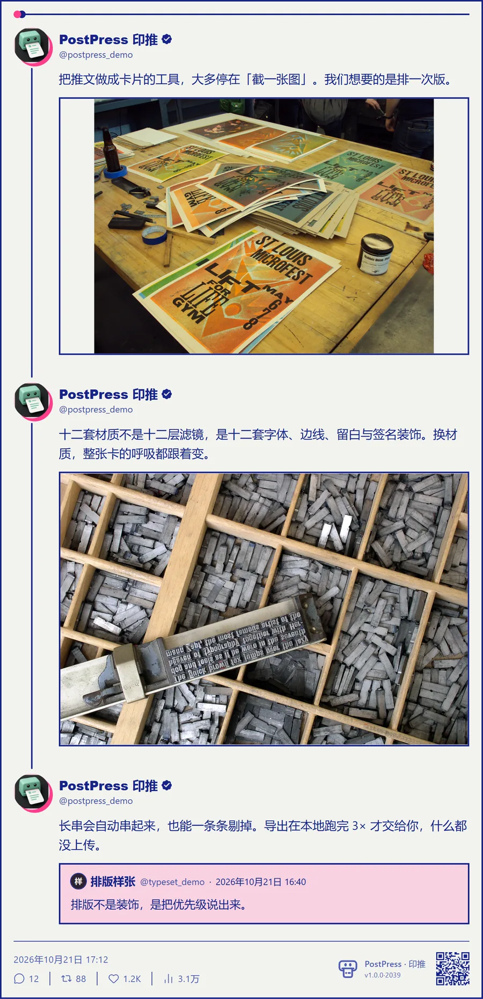 | 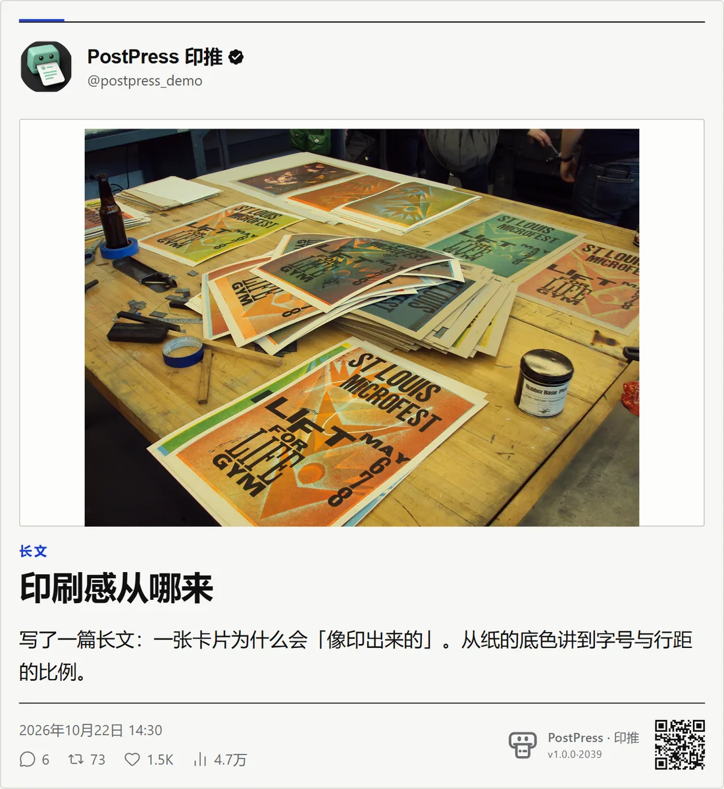 | 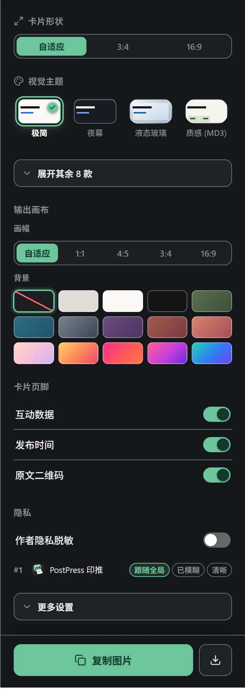 |

### 精细化页脚与作者隐私脱敏

| 完整模式（二维码 + 统计 + 署名） | 极简净版（隐藏全部页脚） | 隐私脱敏（作者头像与账号高斯模糊） |
| :---: | :---: | :---: |
| 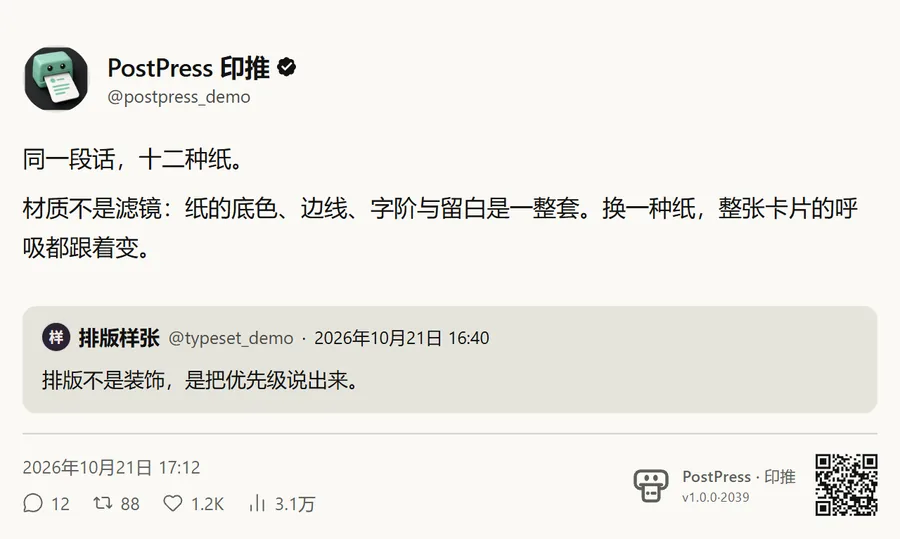 | 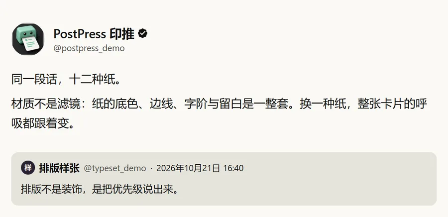 | 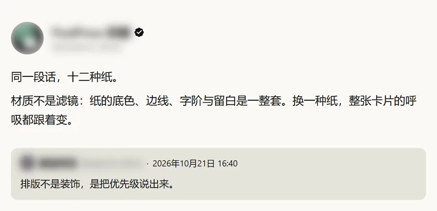 |

---

## ✨ 核心特性

#### 🎨 出版级视觉与装裱体系
- **12 套精心调校的材质主题**：包含 11 套常驻材质（极简、夜幕、液态玻璃、质感 MD3、画廊、暗房、孔版、水墨、软陶、终端、小票）与 1 套实验性材质（粗野派）。每套材质均由专属的纸面基调、边线质感、字体配对、单一强调色与签名装饰线（Signature）共同定义。
- **独立外层画布装裱（Mat）**：支持将卡片承托在外层画布上导出。画幅比例（1:1 / 4:5 / 3:4 / 16:9）与画布背景（跟随主题 / 纯色 / 渐变）彼此独立；画幅采用 `min-height` 弹性下限，长文本平滑向下延展绝不截断；仅选画幅时留白保持透明，便于二次排版合成。
- **14 种界面与卡面语言**：完整适配中（简/繁）、英、日、韩、德、法、西、意、葡、俄、土、乌、印尼 14 个语种，支持自动跟随浏览器或手动锁定，同时本地化弹窗控件与卡面日期格式（不篡改推文原文）。

#### 🔍 双通道深度解析引擎
- **智能长串串联（Thread）**：采用 **GraphQL 结构化缓存优先 + DOM 时序/连接线兜底** 的双通道架构，自动识别并拼接同作者连续推文，精准剔除广告与第三方无关回复，支持在预览中按条自由剔除。
- **长文与富媒体还原**：原生识别 X 长文推文（Article），自动提取封面、眉标、标题与导语；引用推文随材质呈现填充或描边双重质感；完整还原 Twemoji 原生 Unicode 表情、`name=orig` 4K 级原图回退链与 1–4 图自适应网格/堆叠布局。

#### ⚡ 超清导出与隐私防线
- **Retina 级光栅化与手势安全复制**：单条推文默认 3× 超清导出；超长推文串智能适配 2× 以规避社交平台缩放失真（亦可在折叠区强制开启全局 3×「输出最高清晰度」）。点击复制当刻立即锁定系统剪贴板通道（Promise-backed `ClipboardItem`），长图渲染不因瞬时激活超时而中断。
- **逐条作者隐私与可读性警示**：独立控制原文二维码、互动统计、时间戳、视频角标与署名信息；作者高斯模糊支持全局一键开启，也可**直接点击卡片上某条推文的头像仅脱敏该作者**；当长图比例过大、缩至信息流宽度可能导致字号过小时，面板主动呈现可读性警示。

---

## 🛠️ 技术栈

- **UI 与视图层**：[Preact 10](https://preactjs.com/) + TypeScript（严控体积，挂载于 `<post-to-card-container>` 自定义元素的 open Shadow DOM 中，内联 `:host { all: initial }` 实现零样式污染）
- **光栅化引擎**：[modern-screenshot](https://github.com/qq15725/modern-screenshot)（配合 Background Service Worker 跨域图片 Base64 预取代理，彻底根除 Canvas `SecurityError`）
- **矢量二维码与图标**：[qrcode-generator](https://github.com/kazuhikoarase/qrcode-generator)（纯本地离线生成 SVG）+ [lucide-preact](https://lucide.dev/)
- **构建与质量工程**：[Vite 6](https://vite.dev/) 四独立入口构建 + [Knip](https://knip.dev/) 死代码扫描 + Node.js 24 原生 TS 分层验收套件（Tiers 1–5 + CDP 真浏览器像素/动效探针）

---

## 📦 安装与使用

### 直接下载

从 [Releases](https://github.com/Shirolin/post-to-card/releases/latest) 下载 `postpress-1.0.0.zip`，解压到一个固定目录（不要删），然后直接跳到下面的「加载至 Chrome」两步。

### 从源码构建安装

环境要求：**Node.js >= 24**、**pnpm >= 10**。

```bash
# 1. 克隆仓库并安装依赖
git clone https://github.com/Shirolin/post-to-card.git
cd post-to-card
pnpm install

# 2. 执行生产构建（产物输出至 dist/）
pnpm run build
```

加载至 Chrome / Chromium 浏览器：
1. 打开扩展管理页 `chrome://extensions/`，开启右上角「**开发者模式**」。
2. 点击「**加载已解压的扩展程序**」，选择解压后的那个目录（从源码构建时是 `dist/`）。

### 快速上手

| 步骤 | 操作说明 |
| :--- | :--- |
| **1. 唤起面板** | 点击推文操作栏的**印刷机图标**按钮，或将鼠标悬停于推文上按 `Alt + C`（亦可通过浏览器扩展栏弹窗一键触发）。 |
| **2. 定制外观** | 在右侧控制栏切换材质主题、内边距、圆角、卡片画幅与外层画布背景，按需开关页脚二维码与统计元数据。 |
| **3. 编排长串** | 在长推串中点击任意一条即可自动串联上下文；点击单条右上角可将其从当前卡片中剔除，点击头像可单独模糊该作者。 |
| **4. 导出分享** | 点击 **复制图片**（直写系统剪贴板，若受浏览器焦点限制则自动降级为下载）或 **保存 PNG**。 |

---

## 🔒 隐私与安全

PostPress 将「纯本地、零外部服务」作为硬性架构约束：

- **零外部远程通信**：除通过扩展 Background 代理向 X 官方图片域名（`*.twimg.com`，经 `isAllowedHost` 严格校验主机名以防 SSRF）拉取配图外，绝不向任何第三方服务器发起请求。
- **无遥测与追踪**：无统计埋点、无崩溃上报、无远程动态配置。
- **不触碰账号凭据**：不要求登录或 API Key，仅读取当前页面已渲染的 DOM 与页面自身的 GraphQL 响应流；推文内容仅驻留内存，关闭弹窗即释放。
- **最小权限声明**：仅声明 `clipboardWrite`（写入剪贴板）、`storage`（在 `chrome.storage.local` 保存排版偏好）与 `*.twimg.com` 图片代理权限，不申请 `tabs` 或全站读取权限。

完整隐私承诺请参阅 [PRIVACY.md](PRIVACY.md)，安全策略与漏洞报告渠道请参阅 [SECURITY.md](SECURITY.md)。

---

## ❓ 常见问题 (FAQ)

<details>
<summary><b>为什么不直接用系统截屏？</b></summary>

系统截屏受限于当前屏幕 DPI 与浏览器缩放比例，且带有网页 UI 杂讯。PostPress 在完全隔离的 Shadow DOM 中按出版级版式规范以 2× / 3× 分辨率重新光栅化，输出无杂讯、带溯源二维码与材质肌理的独立图像。
</details>

<details>
<summary><b>超长推文串导出后发到社交平台会被压糊吗？</b></summary>

单条推文按 3× 导出，在各平台信息流中依然锐利。对于超长推文串，社交平台按固定宽度等比缩放后会导致正文字号过小，此时面板会主动提示**可读性警示**并建议分段导出；长串默认采用 2× 以控制像素体积，无损分发场景可在「导出设置」中开启「输出最高清晰度」强制 3× 渲染。
</details>

<details>
<summary><b>原推文被删除后，已导出的卡片会受影响吗？</b></summary>

不受影响。导出的 PNG 图像完全离线保存在你的剪贴板或本地磁盘中；扩展不在后台持久化存储任何推文内容，关闭预览弹窗即释放内存。
</details>

<details>
<summary><b>引用公开推文的合规边界是什么？</b></summary>

卡片默认保留原作者昵称、账号、发布时间与原文溯源二维码。公开可见不代表免除版权限制，用于商业用途或大规模分发前请自行确认原作者授权。
</details>

---

## 🏗️ 架构与本地开发


- **双环境隔离通信**：`graphql-hook.js` 在 `document_start` 阶段注入页面主环境（`MAIN` world）拦截推文结构化响应；`content.js` 运行于扩展隔离环境（`ISOLATED` world），双方仅通过 `window.postMessage` 传递净化的推文数据。
- **双通道数据决议**：`resolveThread` 优先消费 GraphQL 结构化树（原生支持 `note_tweet` 全文与长串父子关系），未命中或接口轮换时平滑降级至基于 Snowflake ID、视觉连接线与 DOM 选择器的时序解析。
- **四入口纯净构建**：由 Vite 驱动四个独立构建入口（ESM `background` + IIFE `content` / `popup` / `hook`），运行时依赖严格锁定为 4 个（`preact`、`modern-screenshot`、`qrcode-generator`、`lucide-preact`）。

### 构建与测试门禁

仓库采用分层验证体系，运行门禁**必须严格按顺序执行**（Tier 5 会直接审计刚构建出的 `dist/` 产物并拒绝陈旧构建）：

```bash
pnpm run build       # 1. 类型检查 (tsc + node --check) + 死代码扫描 (knip) + 四入口构建
pnpm test            # 2. Tier 1–4 功能/边界/交互/工作流测试 + i18n / GraphQL / Resolver / Article / Hygiene 专项
pnpm run test:tier5  # 3. Tier 5 对抗性压力与产物取证审计（CORS 防污染、剪贴板降级、Shadow DOM 隔离）
```

### 独立可视化调试 Harness

无需安装扩展或访问 `x.com`，即可在本地浏览器直接调试卡片版式与全部主题状态：

```bash
pnpm exec vite --config dev/vite.harness.config.ts
```

启动后访问 `http://127.0.0.1:5199/preview.html`，支持通过 URL 参数直接切换状态（如 `?theme=riso&ratio=3:4&bg=paper&canvas=4:5`）。更多真浏览器验证脚本（扩展加载、离线真实 DOM 夹具提取、帧率与像素动效探针）详见 [AGENTS.md](AGENTS.md) 与 [CONTRIBUTING.md](CONTRIBUTING.md)。

---

## 📚 文档导航

| 文档 | 内容说明 |
| :--- | :--- |
| [PROJECT.md](PROJECT.md) | 架构全景、功能清单（Feature Inventory）与数据通道设计 |
| [GLOSSARY.md](GLOSSARY.md) | 卡片（Card）、画布（Canvas / Mat）、长串会话等核心领域术语定义 |
| [CONTRIBUTING.md](CONTRIBUTING.md) | 贡献指南、代码规范、架构图更新约定与 PR 流程 |
| [AGENTS.md](AGENTS.md) | 构建门禁链、TypeScript 检查盲区与真浏览器验证脚本指南 |
| [PRIVACY.md](PRIVACY.md) / [SECURITY.md](SECURITY.md) | 隐私合规承诺、权限说明与安全漏洞披露机制 |
| [CHANGELOG.md](CHANGELOG.md) | 版本演进与变更历史 |
| [docs/i18n.md](docs/i18n.md) | 14 国语言字典架构、自动解析规则与 `_locales` 目录规范 |
| [docs/loading-states.md](docs/loading-states.md) | 首帧 `fit` 测量、图片占位、动效取舍原则与像素探针用法 |
| [docs/detection-audit.md](docs/detection-audit.md) | X 平台 DOM 选择器可靠性分级与判据审计 |
| [docs/real-dom-sampling-checklist.md](docs/real-dom-sampling-checklist.md) | 免登录离线采集真实推文 DOM 样本与验证提取器的方法 |
| [docs/architecture-review-2026-10-21.md](docs/architecture-review-2026-10-21.md) | 历史架构决策与「已验证不可行方向」记录 |
| [docs/store-listing.md](docs/store-listing.md) | Chrome 应用商店上架文案（名称、简短说明与详细说明）及与 `_locales` 的同步规则 |
| [docs/store-checklist.md](docs/store-checklist.md) | 上架清单：打包、商店图片、后台字段、隐私声明与常见拒因 |

---

## 🤝 赞助与支持

如果 PostPress 提升了你的创作与分享效率，欢迎支持项目的持续维护：

- **爱发电 (Afdian)**：<https://ifdian.net/a/shirolin>
- **Ko-fi**：<https://ko-fi.com/shirolin>
- **GitHub Star**：在 [Shirolin/post-to-card](https://github.com/Shirolin/post-to-card) 点亮右上角 ⭐ Star，帮助更多人发现它。

欢迎提交 Issue 或 Pull Request 参与贡献！提交前请参阅 [CONTRIBUTING.md](CONTRIBUTING.md)。

---

## 📄 开源许可

本项目基于 **GNU General Public License v3.0 or later**（`GPL-3.0-or-later`）发布，完整条款见 [LICENSE](LICENSE)。

你可以自由使用、修改与再分发本项目（包括商业用途），但**分发修改版本或衍生作品时必须以相同许可公开完整源码**，并保留原始版权与免责声明。卡片右下角的源码署名链接即为遵循 GPL §6 所保留的合规出口。

示例卡片图片中内嵌的第三方作品沿用各自的 CC 许可，署名见 [CREDITS.md](CREDITS.md)。

```text
Copyright (C) 2026 Shirolin

Post-to-Card is free software: you can redistribute it and/or modify it under
the terms of the GNU General Public License as published by the Free Software
Foundation, either version 3 of the License, or (at your option) any later version.
```

<sub>X（Twitter）是 X Corp. 的注册商标。本项目为独立开源工具，与 X Corp. 无任何关联或背书关系。</sub>
