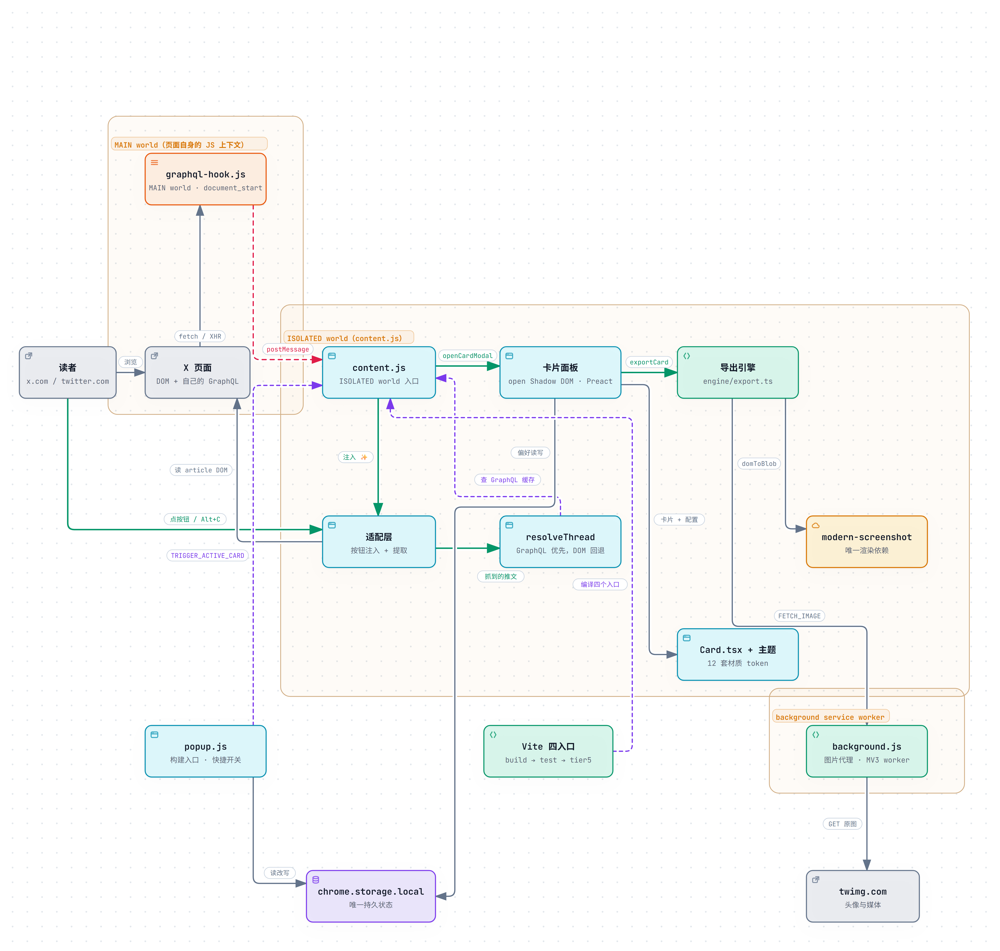

# PostPress · 印推

把 X（Twitter）推文与同作者长串，优雅渲染为出版级高分辨率卡片。

在推文操作栏点击 **✨**（或按快捷键 `Alt + C`），即可在实时弹窗中自由搭配材质、画幅与画布，一键**复制到剪贴板**或**导出 PNG**。所有渲染纯本地完成——不登录、不上传、零外部网络交互。

---

## 核心特性

- **12 套精心调校的材质主题**：包含 11 套常驻材质（极简、夜幕、液态玻璃、质感 MD3、画廊、暗房、孔版、水墨、软陶、终端、小票）与 1 套实验性粗野派。每套主题拥有严谨匹配的纸面基调、边线质感、字体配对、强调色与专属签名装饰。
- **独立外层画布（Mat）**：支持将卡片承托在外层画布上导出。提供 1:1、4:5、3:4、16:9 预设画幅（采用 `min-height` 弹性下限，长文本绝不截断），并支持跟随主题、纯色或渐变背景；仅选画幅时留白保持透明，便于二次合成。
- **智能长串串联（Thread）**：双通道解析（GraphQL 优先 + DOM 降级兜底），自动识别并拼接同作者连续推文，剔除干扰广告与第三方回复，支持单条自由剔除。
- **长文与深度排版**：原生识别 X 长文推文（Article），提取封面与导语；引用推文依主题呈现为填充或描边双重质感；支持 Twemoji Unicode 还原与 1~4 张高清网格图片解析。
- **Retina 级超清导出**：单推默认 3× 超清、超长推文 2× 智能适配（规避平台缩放失真），折叠区提供「输出最高清晰度」全局 3× 强制开关。
- **精细化控制与隐私脱敏**：独立控制原文二维码、互动统计、发布时间戳、视频播放角标与署名版本；提供一键作者信息高斯模糊脱敏。
- **排版防灾与可读性警示**：当长图比例过大、缩至社交平台信息流宽度可能导致字号难以阅读时，面板主动呈现视觉警示，建议分段导出。

---

## 安装

本项目基于 Manifest V3 构建。目前支持通过源码安装（环境要求：Node.js >= 24，pnpm >= 10）：

```bash
pnpm install
pnpm run build
```

构建完成后载入浏览器：
1. 打开 Chrome 扩展管理页 `chrome://extensions/`。
2. 开启右上角「**开发者模式**」。
3. 点击「**加载已解压的扩展程序**」，选择本项目的 `dist/` 目录。

---

## 使用方法

1. **一键唤起**：在推文操作栏点击 **✨** 按钮，或鼠标悬停在推文上按下 `Alt + C`。
2. **实时定制**：在弹窗中按需调整材质主题、画幅比例、外层画布与展示开关。
3. **长串拼合**：在长推串（Thread）中点击任意一条，将自动串联同作者上下文；多余或不想展示的内容可点击「剔除此推文」排除。
4. **高清导出**：点击 **复制图片**（直达系统剪贴板，支持富文本直接粘贴）或 **保存 PNG**。

---

## 常见问题 (FAQ)

**Q: 为什么不直接截屏？**  
A: 普通截屏受限于当前屏幕 DPI 与缩放，夹带浏览器 UI 与杂乱元素。PostPress 在完全隔离的 Shadow DOM 中按主题设计规范以 2×/3× 高分辨率重新光栅化，输出纯净且具有出版质感的卡片。

**Q: 长推文发到信息流中会被压糊吗？**  
A: 单条推文按 3× 导出，缩放至信息流宽度依然锐利。对于超长推文串，等比缩进信息流会导致实际阅读字号偏小，此时弹窗会主动发出**可读性警示**；长串默认采用 2× 规避超大尺寸，无损分发渠道可在「导出设置」中手动开启 3× 极清。

**Q: 需要登录或绑定 X 账号吗？**  
A: 完全不需要。扩展不设任何账号体系，直接读取当前页面已渲染的 DOM 与宿主自身的 GraphQL 缓存，不触碰任何用户凭据，也无需 X API。

**Q: 原帖被删除后，导出的图片会受影响吗？**  
A: 完全不受影响。已导出到硬盘或剪贴板的图片完全归你所有；扩展不在本地持久化存储任何推文内容，关闭预览弹窗即自动释放内存暂存。

**Q: 引用公开帖子的合规边界？**  
A: 卡片完整保留原作者头像、账号、发布时间与溯源二维码。公开可见不代表免责商用，在商用或大规模分发前请自行确认内容版权。

---

## 隐私与安全

- **零外部远程通信**：除了通过安全代理向 X 官方图片域名（`*.twimg.com`）拉取配图（用于规避 Canvas 跨域污染 `SecurityError`）外，绝不向任何外部服务器发送请求。
- **无遥测与追踪**：无数据分析、无行为埋点、无远程动态配置。
- **本地存储保障**：用户的个性化排版偏好仅保存在浏览器本地 `chrome.storage.local`。
- **权限最小化原则**：仅声明 `clipboardWrite`（复制图片至剪贴板）、`storage`（保存用户偏好）及 `twimg.com` 图片代理权限，不请求页面读取或标签管理权限。

完整说明见 [PRIVACY.md](PRIVACY.md)。

---

## 本地开发

### 构建与测试门禁

项目采用分层质量保证体系，门禁顺序**必须严格遵循** `build → test → test:tier5`（Tier 5 门禁直接审查构建产物）：

```bash
pnpm run build       # 类型检查 (tsc) + 静态扫描 (knip) + 四独立入口构建，产物输出至 dist/
pnpm test            # 单元与集成测试：Tier 1-4 与 i18n / GraphQL / Resolver / Article / Hygiene 专项
pnpm run test:tier5  # 对抗性验收测试：针对最新构建产物进行鲁棒性审计
```

### 独立可视化调试 Harness

无需安装扩展或打开 X 页面即可直接在本地浏览器调试卡片排版与主题状态：

```bash
pnpm exec vite --config dev/vite.harness.config.ts
```

在浏览器打开 `http://127.0.0.1:5199/`，可通过 URL 参数快速切换状态进行测试，例如：  
`?theme=riso&ratio=3:4&bg=paper&canvas=4:5`

提交代码前请参阅 [CONTRIBUTING.md](CONTRIBUTING.md)。

---

## 架构设计



- **环境隔离与通信**：`graphql-hook.js` 注入页面主环境（MAIN world）拦截推文的网络请求与响应体；`content.js` 驻留扩展独立环境（ISOLATED world），仅通过标准 `postMessage` 接收数据，保障运行安全。
- **双通道数据决议**：`resolveThread` 优先读取高保真的 GraphQL 结构化缓存；当未命中或网络缺失时，自动平滑降级至基于雪花 ID、视觉连接线与 DOM 标记的时序解析。
- **清晰构建架构**：Vite 驱动的四独立入口（ESM Background + IIFE Content / Popup / Hook），Shadow DOM 注入纯净 CSS 切断样式继承，零外部冗余依赖。

---

## 文档地图

| 文件 | 说明与职责 |
|---|---|
| [PROJECT.md](PROJECT.md) | 需求、功能清单与里程碑 |
| [docs/images/architecture.png](docs/images/architecture.png) | 项目架构图（四个入口、两个 JS world、导出链路） |
| [CONTRIBUTING.md](CONTRIBUTING.md) | 贡献指南、开发工作流与 PR 规范 |
| [CHANGELOG.md](CHANGELOG.md) | 版本演进与更新历史 |
| [PRIVACY.md](PRIVACY.md) | 隐私合规承诺与数据处理范围 |
| [SECURITY.md](SECURITY.md) | 安全策略与漏洞反馈机制 |
| [GLOSSARY.md](GLOSSARY.md) | 卡片 / 画布 / 材质 / 导出等领域术语权威定义 |
| [AGENTS.md](AGENTS.md) | 门禁链、TypeScript 盲区与自动化测试指导 |
| [docs/architecture-review-2026-10-21.md](docs/architecture-review-2026-10-21.md) | 架构审查结论与反思记录 |
| [docs/detection-audit.md](docs/detection-audit.md) | X 平台 DOM 判据有效性审计与规范 |
| [docs/real-dom-sampling-checklist.md](docs/real-dom-sampling-checklist.md) | 离线真实推文样本采集与测试方法 |

---

## 赞助与支持

如果你觉得 PostPress 帮到了你，欢迎支持开发者的持续维护与迭代：

- ❤️ **爱发电 (Afdian)**：[https://ifdian.net/a/shirolin](https://ifdian.net/a/shirolin)
- ☕ **Ko-fi**：[https://ko-fi.com/shirolin](https://ko-fi.com/shirolin)
- ⭐ **Star 支持**：在 [GitHub 仓库](https://github.com/Shirolin/post-to-card) 点击右上角 Star，让更多人发现它！

---

## 开源许可

本项目以 **GNU General Public License v3.0 或更高版本**（`GPL-3.0-or-later`）发布，
全文见 [LICENSE](LICENSE)。

```
Copyright (C) 2026 Shirolin

Post-to-Card is free software: you can redistribute it and/or modify it under
the terms of the GNU General Public License as published by the Free Software
Foundation, either version 3 of the License, or (at your option) any later version.

Post-to-Card is distributed in the hope that it will be useful, but WITHOUT ANY
WARRANTY; without even the implied warranty of MERCHANTABILITY or FITNESS FOR A
PARTICULAR PURPOSE.  See the GNU General Public License for more details.
```

这意味着：你可以自由使用、修改、再分发，包括商用；但**分发修改版时必须以同一许可公开源码**，并保留版权声明与免责声明。卡片右下角的署名链接指向源码，正是为此留的出口（遵循 GPL §6）。

X（Twitter）是 X Corp. 的商标。本项目与 X Corp. 无关联，也未获其背书。
